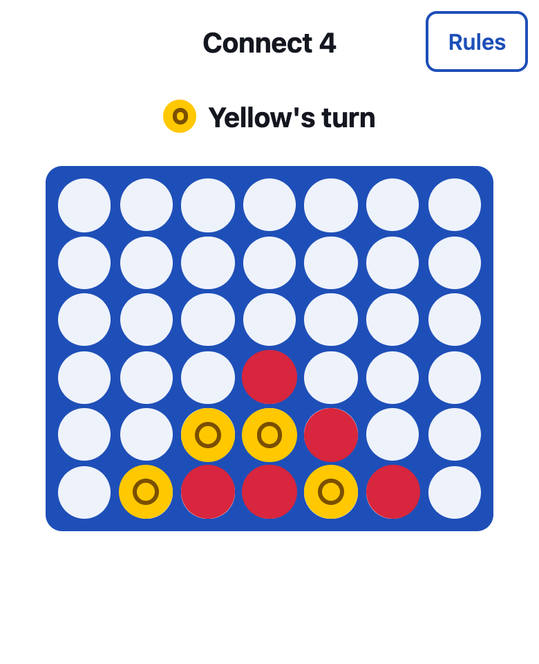
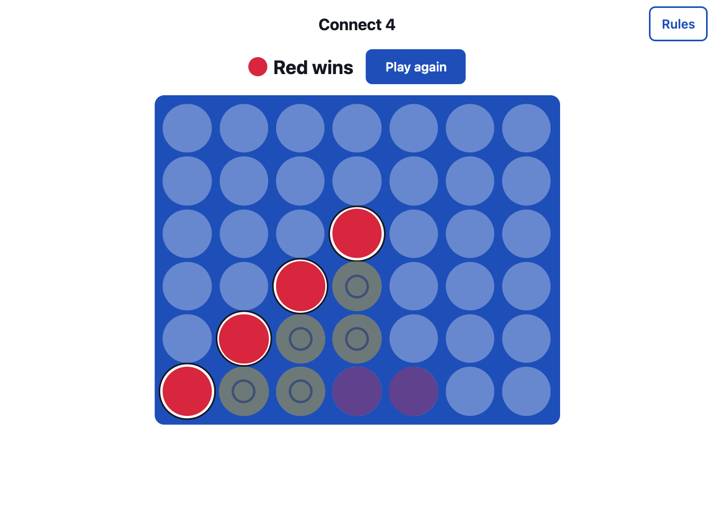
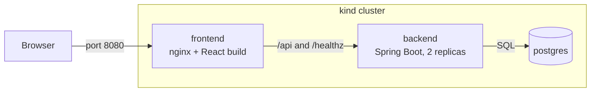

# Connect 4

A two-player Connect 4 that runs on local Kubernetes. Players share a screen. The server decides every move, and games are saved in Postgres, so refreshing the page resumes the same game.

**Stack:** Java 21 and Spring Boot, React and TypeScript (Vite), PostgreSQL, nginx, and Kubernetes through kind.

| A game on a phone | A finished game on a computer |
| :---: | :---: |
|  |  |

## Quick start

On macOS (with [Homebrew](https://brew.sh) installed) or Ubuntu:

```bash
git clone https://github.com/AryanAchuthan07/ConnectFour.git
cd ConnectFour
./scripts/setup.sh   # installs any missing tools
make up              # builds the app and starts it
```

Then open **<http://localhost:8080>**. The first `make up` downloads images and dependencies, so it takes a few minutes.

**The setup script may ask you to finish a step**, then run it again:

- **macOS:** open Docker Desktop and accept its terms. Check that its license covers your use.
- **Ubuntu:** give your user access to Docker with the command the script prints, then log in again. That access is equivalent to root.
- **Windows:** use Ubuntu on WSL2, with Docker Desktop installed and WSL integration enabled for that distribution. This route hasn't been tested.

`./scripts/setup.sh --dry-run` shows what would be installed without changing anything.

**Prerequisites,** if you'd rather install them yourself: Docker with Compose and Buildx, kind, kubectl and `make`. No Java or Node is needed to run or test the project.

> [!WARNING]
> **`make up` and `make down` erase all saved games.** `make up` always starts with a new, empty cluster, as it would on a new computer.

| Command | What it does |
| --- | --- |
| `make up` | Builds both images, recreates the `connectfour` kind cluster and starts the app |
| `make test` | Runs all tests in containers, using a temporary database. It doesn't touch the running app |
| `make down` | Deletes the cluster |

`make up` also switches your current `kubectl` context to `kind-connectfour`.

## Playing

Choose **New game**. Red goes first. Pick a column by clicking, tapping, or using the Left and Right arrows and then Enter or Space. Four or more in a row wins. The **Rules** button explains the rest.

Each game has its own address, `/game/<id>`. Refreshing it or opening it again resumes the game.

### From a phone or another computer

`make up` also prints an address for other devices, such as `http://192.168.1.20:8080`.

1. Connect both devices to the same network.
2. Type the address in full, starting with `http://`. HTTPS isn't supported.

This isn't available over the internet. **There are no accounts, so anyone on your network who can reach the address can use the app.**

## Development

For faster changes, only the database runs in Docker. This needs **JDK 21 or newer** and **Node 22.22.2+ (within 22), 24.15+ (within 24), or 26+**. `./scripts/setup.sh --dev` installs them if missing, along with the frontend libraries.

Run each of these in its own terminal, from the project folder:

```bash
docker compose up                            # database, on port 5433
cd backend && ./mvnw spring-boot:run         # backend, on port 8081
cd frontend && npm ci && npm run dev         # open http://localhost:5173
```

The frontend updates as you save. Restart the backend after Java changes. The development database keeps its data until `docker compose down -v`.

`cd frontend && npm test` runs only the frontend tests. `cd backend && ./mvnw test` needs the development database to be running.

## How it works



- The browser sends a column and the number of moves it has seen. The server checks the move, saves it and returns the whole game. The frontend never works out a winner.
- Each move is one database transaction that locks the game's row, so two moves sent together can't both be saved.
- The game rules are plain Java in their own package, with no web or database code.

```
backend/    game (rules), store (SQL), api (HTTP)
frontend/   React app and its tests
k8s/        Kubernetes manifests and the kind cluster config
scripts/    setup.sh
docs/       PRD.md, DECISIONS.md, TRANSCRIPT.md
```

**Tests** cover the game rules, the database and API against a real Postgres (including simultaneous moves), and the interface in a simulated browser.

## Troubleshooting

| Problem | What to try |
| --- | --- |
| `make up` fails because port 8080 is in use | Stop whatever is using it. `lsof -nP -iTCP:8080 -sTCP:LISTEN` shows what that is |
| `docker` commands can't connect | Start Docker. On macOS: `open -a Docker` |
| "Permission denied" from Docker on Ubuntu | Complete the Docker access step above and log in again |
| Docker Desktop can't start because installing Rosetta failed | Choose **Disable Rosetta**. This project doesn't need it |
| A phone can't open the app | Check that both devices are on the same network and the address starts with `http://`. Turn off VPNs. Check the computer's firewall. Guest, school and public networks often block devices from reaching each other |
| The phone address stopped working | The computer's address can change with the network. On a Mac, run `ipconfig getifaddr en0`. The printed address may be wrong or missing if the connection isn't `en0` |
| An old game link says the game wasn't found | `make up` or `make down` erased it |
| The development database can't start | Port 5433 may be in use |

## What's been tested

| Environment | What was checked |
| --- | --- |
| **macOS on Apple silicon, Docker Desktop** | `make up`, `make test` and browser checks in headless Chrome. Also played on an iPhone over the local network |
| **macOS on Apple silicon, Colima** | `make up` and `make test` worked on an early version, but **a phone couldn't connect**. Switching to Docker Desktop fixed that. The exact cause wasn't found |
| **Ubuntu 24.04 on ARM, virtual machine** | `setup.sh --dev`, `make test` and `make up`, on an early version without the game |
| **Ubuntu 22.04 and 24.04 on ARM, and 24.04 on emulated Intel/AMD, in containers** | The setup script installs the tools, and the frontend tests pass. Docker doesn't run inside these containers, so the app wasn't started. On Docker Desktop's emulator (Rosetta off), `docker compose` and `docker buildx` crashed in the Intel/AMD container. On Colima's emulator they worked |

**Not tested:** Windows with WSL2, physical Intel or AMD computers, setup on a Mac that's actually missing the tools, and Android phones.

## More

- [Product requirements](docs/PRD.md)
- [Decisions, trade-offs, known limitations and next steps](docs/DECISIONS.md)
- [Transcript of the AI-assisted build](docs/TRANSCRIPT.md)
