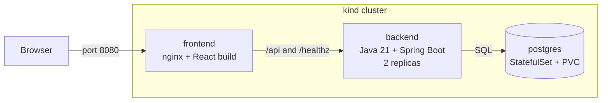

# Connect 4 Take-Home PRD

Nov 26, 2026 * @Aryan

## Overview

Build a polished, server-authoritative Connect 4 that two players can play in one browser, with games saved to Postgres so a refresh never loses a game. Everything runs on local Kubernetes with one command, in about 4 hours.

**Goal:** a small game that feels finished, backed by a clean, tested codebase, rather than a big game that is half-built.

**Success criteria**

- A new player can start, play and finish a game with no instructions.
- Illegal moves are impossible: the server rejects them, not just the UI.
- Refreshing the page or reopening the game link resumes the same game.
- `make up` on a clean machine (with Docker, kind, kubectl and `make` installed) brings the whole stack up. This works on macOS, Linux and Windows through WSL2.
- While it's running, phones and other computers on the same network can play in a browser.
- The win-detection logic has unit tests covering every direction and edge case.

**Stack:** Java 21 + Spring Boot backend, React + TypeScript (Vite) frontend, PostgreSQL, Docker, Kubernetes via kind.

## Scope

There are three levels. **Must** features are required to submit. **Polish** comes after them and is the first thing cut. **Stretch** items start only after the submission phase is done, in order, and only when everything above them works and is committed.

| Priority | Feature | Why |
| --- | --- | --- |
| Must | Local two-player game (same screen) | The core loop; everything else depends on it |
| Must | Server-side move validation and win/draw detection | The rules can't be bypassed, and the logic stays testable |
| Must | Games saved in Postgres, resumable via URL | Gives the database a real job; refreshing never loses a game |
| Must | Turn indicator, winning-line highlight, draw state, rematch | Makes the game feel finished |
| Must | One-command local run on Kubernetes | Explicitly requested |
| Must | Landing-spot preview for mouse and keyboard | Players should always know where the piece will land |
| Must | Rules button that explains how to play | A new player can look up the rules and controls without leaving the game |
| Must | Keyboard play and phone-sized portrait layout | Part of the quality bar, and cheaper to build into the board than to add later |
| Polish | Drop animation, off when reduce-motion is on | Adds feel, but the game is complete without it |
| Stretch 1 | Online play from two browsers via a shareable link (polling) | Uses the backend you already have |
| Stretch 2 | Simple computer opponent (block or win in one, else random) | Solo play |

**Out of scope (goes in "what I'd do next"):** accounts and login, ratings or Elo, WebSockets, chat, game history and replays, a strong AI, production deployment, Helm charts.

## Game rules and edge cases

Standard Connect 4: a 7-column × 6-row board, and Red always moves first. A move is a column choice; the piece falls to the lowest empty row.

- **Win:** four or more in a row horizontally, vertically or on either diagonal. The game ends right away and the server returns all winning cells: every cell in every line of four or more through the last piece. This can be more than four cells, when a line is longer than four or one move completes several lines.
- **Draw:** all 42 cells are filled and nobody has won.
- **Rejected moves (server returns an error, state unchanged):**
  - column outside 0–6
  - full column
  - game already finished
  - wrong player's turn (matters once online play exists)
  - stale move: the client's move count doesn't match the server's, for example after a double-click or in a second tab
- **Rematch:** creates a new game; the finished game stays saved.

The win check only needs to look at lines through the last piece placed, which keeps it simple and fast.

## UX requirements

The player should always know whose turn it is, where the piece will land and why the game ended. The one exception is that touch players get no landing preview before a move.

**Screens:** a home screen with a "New game" button, then the game screen at `/game/:id`. Keep it to those two.

**Game screen**

- The board is the focus: centred, large, with clearly different Red and Yellow pieces.
- A turn indicator shows the current player's colour.
- A full column shows as disabled. The whole column is the click and tap target. How a move is previewed and made depends on the input:
  - **Mouse:** hovering over a column shows a ghost piece where the move would land, and clicking drops the piece.
  - **Keyboard:** the selected column shows the ghost piece, arrow keys move between columns, and Enter drops the piece.
  - **Touch:** one tap drops the piece, with no preview first. No ghost piece remains after the tap.
- After a move, disable input until the server responds, so a double-click can't send two moves.
- When the game ends, a banner shows the result ("Red wins" or "Draw"), all winning cells are highlighted, and a "Play again" button appears.
- A server error shows a short, friendly message, never a blank screen. For a network failure or a response it can't read, such as an nginx 502 or 504 page, the frontend shows "Can't reach the server. Please try again."
- After any 409, the frontend fetches the game again and keeps showing the error message, so an out-of-date tab recovers without a refresh. It does the same after a failed move caused by a network failure, a timeout, an unreadable response or a server error, because the move may have been saved even though the response was lost. If reloading also fails, moves stay locked and a "Try again" button appears.
- If a game can't be loaded for any other reason, such as an unreachable server, the screen shows the error with a "Try again" button.
- Requests time out after 20 seconds, so the controls never stay locked indefinitely.
- A piece appears only after the server accepts the move.
- Besides colour, pieces differ in shape: Yellow pieces have a centre ring and Red pieces are solid.
- When the game opens, the middle column is focused. Enter or Space drops a piece, and holding the key down doesn't repeat the move. Tab enters the board once. Full or temporarily locked columns are marked unavailable but stay focusable.
- If the interface itself crashes, a fallback message and a reload button replace the blank screen.
- If the game at the URL can't be loaded because the ID is invalid or unknown, the screen says "We couldn't find that game" and offers a "New game" button.

**Rules popup**

- A "Rules" button sits in the top right of the home, game and "game not found" screens, without pushing the board off a phone screen.
- It opens a popup over the current screen, not a third screen. The popup covers how to play and the mouse, touch and keyboard controls. It never opens by itself, and the game must still be playable without reading it.
- It closes with the Close button, Escape or a press outside it, and keyboard focus returns to the Rules button. Close stays at the top, in view while the rules scroll.
- While it's open, the board behind can't be used. Opening and closing it sends nothing to the server, and a move already sent still finishes.
- It uses the browser's `<dialog>` element, with no new dependency. The test browser lacks `showModal`, so blocking the page, Escape and layout are checked in a real browser.

**Quality bar**

- Works on a phone-sized screen in portrait.
- Keyboard play: arrow keys pick a column, Enter drops the piece. The focus is visible.
- Colour isn't the only signal: the turn indicator and result banner also use words.
- Animation (polish): the piece drops in about 300 ms; turn it off when the system's reduce-motion setting is on.

## Data model and API

There are two tables. `games` holds the current state, so loading a game is a single read. `moves` is an append-only log that gives you history for free and blocks duplicate moves.

**games**

| Column | Type | Notes |
| --- | --- | --- |
| id | UUID, primary key | Also used in the game URL |
| board | TEXT(42) | One character per cell (`.`, `R` or `Y`), stored row by row |
| current\_player | TEXT | `R` or `Y` |
| status | TEXT | `in_progress`, `red_won`, `yellow_won` or `draw` |
| winning\_cells | JSONB, nullable | e.g. `[[5,0],[5,1],[5,2],[5,3]]` |
| move\_count | INT | Doubles as the optimistic-lock version |
| created\_at, updated\_at | TIMESTAMPTZ |  |

**moves:** `game_id` (foreign key), `move_number`, `player`, `col`, `created_at`. A unique constraint on (`game_id`, `move_number`) means two moves can never land on the same turn.

**Game object** (this example shows Red after winning along the bottom row)

```json
{
  "id": "3f2b8c1e-9d4a-4e7b-a1c6-5f0d2e8b9a34",
  "board": [
    [".", ".", ".", ".", ".", ".", "."],
    [".", ".", ".", ".", ".", ".", "."],
    [".", ".", ".", ".", ".", ".", "."],
    [".", ".", ".", ".", ".", ".", "."],
    ["Y", "Y", "Y", ".", ".", ".", "."],
    ["R", "R", "R", "R", ".", ".", "."]
  ],
  "currentPlayer": "R",
  "status": "red_won",
  "winningCells": [[5,0], [5,1], [5,2], [5,3]],
  "moveCount": 7
}
```

- `board` is a 2D array, `board[row][col]`, in both the API and the game logic. The game logic copies it before applying a move. The 42-character string is only the storage format, and the backend converts between the two.
- Cells and `status` use the same values as the database.
- `winningCells` is a list of `[row, col]` pairs with no duplicates, sorted by row and then column. It is `null` unless someone has won.
- `currentPlayer` doesn't switch after the move that ends the game. The UI ignores it once the game is over.
- Timestamps aren't returned because neither screen uses them.

**Endpoints** (JSON; every game endpoint returns the full game object)

| Method and path | Request body | Responses |
| --- | --- | --- |
| `POST /api/games` | none | 201 with the new game |
| `GET /api/games/{id}` | none | 200; 400 for an invalid ID; 404 |
| `POST /api/games/{id}/moves` | `{"column": 3, "moveCount": 7}` | 200 with the updated game; 400 for an invalid request or a bad column; 409 for a full column, a stale move count or a finished game; 404 |
| `GET /livez` | none | 200 without touching the database; used by the liveness and startup probes |
| `GET /healthz` | none | 200 with `{"status": "ok"}` if Postgres responds, otherwise 503; used by the readiness probe |

Errors use a single shape: `{"error": {"code": "COLUMN_FULL", "message": "That column is full."}}`. The frontend shows the message as is.

**Error checks:** a request can break more than one rule, so the server runs these checks in order and returns the first failure. The API handles checks 1–3, and the `game` package handles checks 4–6. `GET /api/games/{id}` uses only checks 1 and 2.

| Order | Check | Status | Code | Message |
| --- | --- | --- | --- | --- |
| 1 | The game ID is valid and, for a move, the body is valid JSON with both fields as integers | 400 | `INVALID_REQUEST` | That request wasn't valid. |
| 2 | The game exists | 404 | `GAME_NOT_FOUND` | We couldn't find that game. |
| 3 | The move count matches | 409 | `STALE_MOVE` | The game has changed. Check the board and try again. |
| 4 | The game is still in progress | 409 | `GAME_OVER` | This game is already over. |
| 5 | The column is from 0 to 6 | 400 | `INVALID_COLUMN` | That column doesn't exist. |
| 6 | The column has space | 409 | `COLUMN_FULL` | That column is full. |

**Requests outside the API:** these use the same error shape.

| Case | Status | Code | Message |
| --- | --- | --- | --- |
| Unknown `/api` path | 404 | `NOT_FOUND` | We couldn't find that. |
| Wrong method on a supported path | 405 | `METHOD_NOT_ALLOWED` | That action isn't allowed. |

**Strict move requests:** `column` and `moveCount` must be JSON integers that fit in 32 bits. Strings, decimals, booleans, `null` and missing fields are an `INVALID_REQUEST`. Game IDs must be in the standard 36-character UUID format. Extra fields are ignored, and the body is read as JSON whatever content type the request claims.

Unexpected errors return 500 `INTERNAL_ERROR` with "Something went wrong. Please try again." They use the same shape and don't expose internal details. The wrong-turn rejection gets its place in this order when online play is built, because requests don't yet say which player is moving.

**Move handling:** in one transaction, lock the game row (`SELECT … FOR UPDATE`), check that the request's `moveCount` equals `move_count`, run the pure game logic, insert into `moves` with `move_number = move_count + 1`, update `games` (including incrementing `move_count`), then commit.

**Move counting:** `moveCount` in the request is the number of moves already made, as the client last saw it. The client sends back the game's count unchanged, so the first move of a new game sends `0`. Rows in `moves` are numbered from 1.

## Architecture

The backend is the single source of truth. The browser sends a column choice, and the backend validates it, saves it and returns the full new game state.



Game rules live in a pure `game` package with no HTTP or database code, so they can be unit-tested on their own. The frontend never computes a winner; it only displays what the server returns.

## Infrastructure and run command

`make up` builds both images, deletes the project's kind cluster if it exists, creates a new one, loads the images into it and applies plain Kubernetes manifests. The game is then at `http://localhost:8080`.

**Cluster lifecycle:** `make up` always recreates the cluster, so each run starts with an empty cluster and database, as a reviewer's first run would. It's for checking what the reviewer will see; day-to-day development uses Docker Compose. `make down` deletes the cluster. Both touch only this project's named cluster. Saved games survive browser refreshes and pod restarts, but **not** `make down` or another `make up`. The README says so.

**Kubernetes resources (`k8s/`)**

- `postgres`: a StatefulSet with one replica, a PersistentVolumeClaim and a Service. Credentials come from a Secret; local-only values are fine.
- `backend`: a Deployment with 2 replicas (this shows the backend holds no state) and a Service. It reads `DATABASE_URL` from the Secret. An init container waits for Postgres before the backend starts.
- Backend health checks: readiness uses `/healthz`, so a pod that can't reach Postgres gets no traffic. Liveness uses `/livez`, so a database outage doesn't restart the backend. A startup probe on `/livez`, with a generous time limit, holds off liveness checks while Java starts and Flyway runs. The trade-off, for `DECISIONS.md`: a pod whose database connections stay stuck loses traffic but isn't restarted.
- Backend shutdown: a `preStop` hook waits 5 seconds before a pod being replaced shuts down, so Kubernetes can stop sending it traffic first. This needs a Kubernetes version that supports the `sleep` hook; kind 0.33.0 does. In testing without it, 9 of 467 health checks failed with 504 across three backend restarts. With it, all 474 succeeded. That doesn't guarantee a restart never drops a request.
- `frontend`: a Deployment and a Service. nginx serves the built static files and forwards `/api` and exactly `/healthz` to the backend Service, so there are no cross-origin (CORS) issues. It doesn't forward `/livez`. Other unknown paths serve the React app, so refreshing `/game/:id` works.
- Access: a kind port mapping from port 8080 on all of the host's network interfaces to a fixed NodePort on the frontend Service. The app is at `http://localhost:8080` on the host and at `http://<host IP>:8080` from other devices on the same network. There are no accounts, so anyone who can reach that address can use the app. Only the app is exposed; the development database accepts local connections only. The mapping is defined in `k8s/kind.yaml` and set when the cluster is created, and the port numbers there must match the Service. `make up` passes this file to kind and doesn't apply it with the manifests. It waits until everything is ready, prints both URLs and exits. The README notes that port 8080 must be free, and that a firewall or a network that isolates devices can block access from other devices.

**Database migrations:** Flyway applies versioned SQL files when the backend starts, which Spring Boot supports out of the box. That's fine for this scope; a real project would use a separate migration job.

**Images:** multi-stage Dockerfiles. The backend is built with Maven and runs on a slim Eclipse Temurin JRE image, so no JDK is needed on the host; the frontend is built with Node and served by nginx.

**Dev loop:** Docker Compose runs only Postgres. The backend and the Vite development server run directly on the host, for the fastest iteration.

- `docker compose up` starts the development database. It persists between restarts, and `docker compose down -v` clears it.
- The backend runs through the Maven wrapper (`./mvnw spring-boot:run`), so Maven doesn't need to be installed. It uses port 8081 on the host, leaving 8080 for kind. Its default database settings match the Compose database.
- The app is at `http://localhost:5173`. Vite forwards `/api` and `/healthz` to the backend, as nginx does.
- The project targets Java 21 (`maven.compiler.release`), even when the host JDK is newer. `make test` and the images use Java 21.
- `make test` uses a separate Compose project, so its cleanup can't remove development data.
- This setup doesn't use nginx, so run `make up` at the end of each phase from Phase 2 onward to catch differences, such as a failed refresh on `/game/:id`.

**Prerequisites** (listed in the README): Docker with Docker Compose and Buildx, kind, kubectl and `make`. These are all that's needed to run and test the project. The dev loop also needs a JDK (21 or newer) and Node (22.22.2+ within version 22, 24.15+ within version 24, or 26 or newer, as the test tools require) on the host. On Windows, run the commands inside WSL2.

**Setup script:** `./scripts/setup.sh` installs the tools needed to run and test, and `--dev` adds a JDK, Node and the frontend libraries. `--dry-run` shows what it would install. It skips tools that are already there and checks that Docker is running.

- It supports macOS, which needs Homebrew first, and Ubuntu, including Ubuntu on WSL2. On other systems it stops with instructions, and users install the tools themselves.
- Some first-time steps stay manual, and the script prints them: opening Docker Desktop and accepting its terms, enabling Docker's WSL integration on Windows, and giving a Linux user access to Docker. It doesn't grant that access itself, because it's equivalent to root access.
- If Docker Desktop on macOS can't start because installing Rosetta failed, choose **Disable Rosetta**. This project doesn't need it. The script and the README say so.
- On Ubuntu, kind, kubectl and Node are downloaded at fixed versions and checked against checksums in the script.
- Project libraries aren't listed in the script. Maven reads `pom.xml`, and npm reads `package-lock.json`.

**Running tests:** `make test` runs everything in containers, so the host needs no JDK or Node. It uses Docker Compose to start a separate, empty Postgres and a Maven container, then removes them, whether the tests pass or fail. Game logic tests run without Spring or a database.

## Testing and conventions

Put most of the tests on the pure game logic, where bugs would hurt players most and tests are cheapest to write.

**Tests**

- **Game logic (must):** JUnit 5 parameterized tests. Cover a win in each direction (horizontal, vertical, both diagonals), wins at the board edges, a line longer than four, two winning lines from one move, a draw on a full board, a full column, an out-of-range column, a move after the game is over, and turn alternation.
- **API (must):** a few MockMvc controller tests against real Postgres, for the main path and for the 409 cases (stale move count, full column). No mocked store and no Testcontainers.
- **Concurrency (must):** send two moves with the same `moveCount` at the same time. One returns 200, the other returns 409 `STALE_MOVE`, and only one move is saved.
- **Frontend (must):** Vitest with jsdom, React Testing Library and User Event, all development-only. Tests cover `api.ts` and the displayed app, with only `fetch` faked. `make test` type-checks and runs them in a Node container. A simulated browser can't check layout or visible focus, so styling is checked in a real browser.

**Repository layout**

```
backend/   Maven project; packages game (pure logic), store (JDBC), api (controllers)
frontend/  src/components (Board, Cell, StatusBar), src/screens (HomeScreen, GameScreen), src/api.ts, src/router.ts, src/hooks/useGame.ts
k8s/       kind.yaml (cluster config), postgres.yaml, backend.yaml, frontend.yaml, secret.yaml
docs/      PRD.md, DECISIONS.md
scripts/   setup.sh (installs the required tools)
Makefile   up, down, test
```

**Conventions**

- `game` doesn't import Spring or anything about HTTP or the database. Controllers stay thin: decode the request, call the store and the game logic, encode the response.
- The board is shared by row and column index; row 0 is the top row.
- Small commits, each with a clear message, one logical step at a time.
- No dependency without a reason: Spring Boot (web, JDBC, Flyway) and the Postgres driver, with no JPA or Hibernate; React with no state-management library.

## Build phases and time budget

Work through six phases totalling about 4 hours, with the riskiest part (infrastructure) first. Commit at the end of each phase and note the actual time spent.

1. **Plan (20 min):** finish this PRD and CLAUDE.md. *Done when:* both are committed.
2. **Walking skeleton (60 min):** repo layout, Dockerfiles, Kubernetes manifests, a backend `/healthz` that pings Postgres and a `/livez` that doesn't, and a frontend that shows the API status. It shows "API OK" only when `/healthz` returns both status 200 and `{"status": "ok"}`. *Done when:* `make up` on a fresh cluster shows "API OK" in the browser.
3. **Game logic, storage and API (60 min):** `game` and its tests first, then the migration, the store and the three endpoints. *Done when:* `make test` passes and a full game can be played with curl.
4. **Frontend (70 min):** board, turn indicator, hover preview, keyboard play, phone layout, game-over banner with winning-line highlight and rematch, routing to `/game/:id`, error handling. Replace the API status display with the home screen; keep the `/healthz` nginx rule for checking the whole stack with curl. *Done when:* a full game can be played in the browser, by mouse or keyboard and on a phone-sized portrait screen, and survives a refresh.
5. **Polish (15 min):** drop animation with its reduce-motion setting, then trying to break it. *Done when:* nothing obvious breaks.
6. **Submission (15 min):** README (setup command, single run command, screenshot or GIF), DECISIONS.md (trade-offs and what's next), the time breakdown and the transcripts. Before submitting, build both images once with `docker build --no-cache --pull`, so cached layers can't hide a broken download or build step. `make up` normally uses the cache.

**If a phase overruns by 15 minutes**, cut from Polish first (the drop animation before the break test), never from Must features, tests or the README. If time runs short, still do a brief break test. Only start a stretch feature after phase 6 is done.

## Decisions and next steps

- **Backend:** Java 21 + Spring Boot, chosen over Go and PHP.
- **Frontend:** React + TypeScript (Vite).
- **One-command run:** kind.
- **Priority levels:** hover preview, keyboard play and phone layout are Must; the drop animation is Polish.
- **First stretch feature:** online play.

**"What I'd do next"** (for the submission note): real-time online play over WebSockets with matchmaking; accounts and game history with replays; a minimax computer opponent with difficulty levels; end-to-end tests with Playwright.
